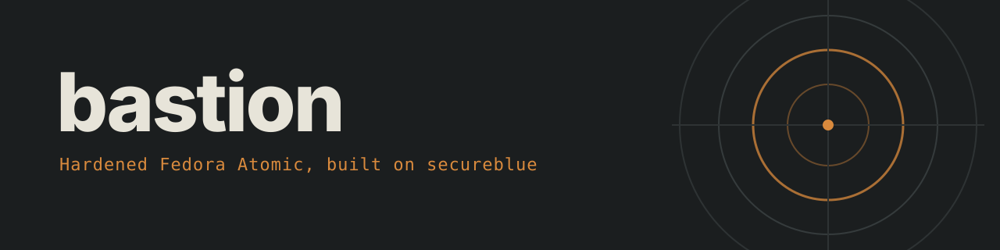

<p align="center"></p>

<p align="center">
  <a href="https://github.com/opus-oss/bastion-atomic/actions/workflows/build.yml"></a>
  
  
  
</p>

bastion is a hardened Fedora Atomic desktop image built on top of secureblue, and this repo holds everything it changes.

- **Layers**
  - Fedora Silverblue is the stock Fedora Atomic GNOME desktop.
  - secureblue hardens Silverblue with its own kernel build, SELinux confinement, hardened_malloc, run0 and USBGuard.
  - bastion hardens secureblue further with DNS over HTTPS only, an nftables firewall and a clock set from HTTPS servers.
- **How it's built**
  - The image starts from `ghcr.io/secureblue/silverblue-main-hardened` and adds only what's in this repo.
  - GitHub Actions rebuilds and signs it every night, which brings in secureblue's fixes without anyone merging them by hand.
  - Nothing is compiled or layered on the installed machine.

## Install

- **Requirements**
  - You need a fresh [secureblue](https://secureblue.dev/install) install of the GNOME (Silverblue) variant.
- **Steps**
  - Run the installer, then reboot:
    ```sh
    git clone https://github.com/opus-oss/bastion-atomic.git
    cd bastion-atomic
    run0 bash install.sh
    ```
- **What the installer does**
  - It adds this repo's signing key to the system's container policy before it pulls anything.
  - It then rebases with `ostree-image-signed:`, which refuses any image that isn't signed with that key.
  - Your secureblue deployment stays in the boot menu as a way back.
- **Updates**
  - New builds arrive as ordinary `rpm-ostree upgrade`s and apply on reboot.
  - `rpm-ostree rollback` returns to the previous build.

## What bastion adds to secureblue

- **DNS over HTTPS only** (replaces secureblue's Unbound DNS-over-TLS)
  - dnscrypt-proxy runs on loopback and sends DoH over port 443 to Quad9, Cloudflare and Mullvad.
  - NetworkManager ignores DNS servers offered by DHCP.
  - DNS-over-TLS needs port 853, which some networks reset, while DoH on 443 gets through them.
  - Files: `etc/dnscrypt-proxy/`, `etc/NetworkManager/conf.d/zz-bastion-dns.conf`, `etc/resolv.conf`.
- **nftables firewall** (replaces firewalld)
  - All inbound traffic is dropped, and ping goes unanswered.
  - Nothing is forwarded except libvirt's virtual bridges.
  - Outbound plaintext DNS on ports 53, 5353 and 5355 is rejected, which stops any program from going around the encrypted resolver.
  - File: `etc/nftables/bastion.nft`.
- **HTTPS quorum clock** (replaces chrony with NTS)
  - The clock is set from the `Date` headers of HTTPS servers, and there's no NTP client at all.
  - It asks one server from each of 5 independent pools and moves the clock only when at least 3 of them agree within 2 seconds plus their measured error.
  - Files: `usr/lib/bastion-timesync.py`, `etc/bastion/timesync.json`.
- **Signed images and build provenance**
  - Every image is signed with cosign, and rpm-ostree checks that signature on every pull.
  - CI also attaches a GitHub build-provenance attestation to each image.
  - File: `.github/workflows/build.yml`.
- **Stricter ptrace**
  - `kernel.yama.ptrace_scope` is 2, which limits ptrace to admins, where secureblue sets 1.
  - File: `etc/sysctl.d/90-bastion.conf`.
- **Five more blocked kernel modules**
  - bastion also blocks `mei` and `mei-me` (Intel ME), `sp5100_tco`, `pcspkr` and `uvcvideo`.
  - secureblue leaves the webcam as a toggle, while bastion blocks `uvcvideo` outright.
  - File: `etc/modprobe.d/90-bastion-blocked.conf`.
- **Text-only boot**
  - `plymouth.enable=0` gives a plain console LUKS prompt and removes a 3.4-second `plymouth-quit-wait` delay.
  - File: `usr/lib/bootc/kargs.d/20-bastion.toml`.
- **Opus theme**
  - GNOME Shell is recoloured at build time in dark slate with an amber accent (`#d98a3d`).
  - libadwaita, GTK3, Ptyxis and Text Editor use the same colours, with Inter and JetBrains Mono fonts.
  - The login screen shows no logo.
  - Files: `etc/dconf/`, `usr/share/opus-theme/`.
- **Whonix**
  - `whonix.sh` installs Whonix under libvirt after checking its signing key fingerprint and signatures.
- **Overlap with secureblue**
  - 17 of the 18 sysctls and 41 of the 46 blocked modules repeat secureblue's own settings on purpose, and they'll stay in place if secureblue ever changes its defaults.

## What secureblue adds to Silverblue

> [!NOTE]
> Everything in this section is secureblue's work, not this repo's.
>
> - Feature list: [secureblue.dev/features](https://secureblue.dev/features)
> - Source: [github.com/secureblue/secureblue](https://github.com/secureblue/secureblue)

- **Kernel**
  - secureblue rebuilds Fedora's kernel and signs it with its own key, which shim and MOK accept under Secure Boot.
  - It adds 37 kernel arguments, including `lockdown=confidentiality`, `module.sig_enforce=1`, `init_on_alloc=1`, `init_on_free=1`, `mitigations=auto,nosmt`, `iommu.strict=1`, `pti=on`, `slab_debug=FZ` and `random.trust_cpu=off`.
  - Its sysctls restrict kernel pointers and dmesg, turn off unprivileged BPF and kexec, restrict perf, and refuse ICMP redirects and source routing.
  - Its module blacklist covers rare network protocols and filesystems, FireWire and Thunderbolt, and Bluetooth and the webcam start off.
- **Memory**
  - hardened_malloc replaces glibc's allocator system-wide, inside Flatpaks too.
- **Confinement**
  - SELinux confines a hardened Chromium browser (Trivalent) and restricts socket classes.
  - Unprivileged user namespaces are blocked for unconfined and container domains.
- **Root access**
  - sudo, su and pkexec are gone, and `run0` takes their place.
  - Every setuid bit under `/usr` is stripped, with file capabilities where a program needs them.
- **Desktop**
  - Xwayland, thumbnailers and user GNOME extensions are off by default.
- **Network**
  - firewalld ships with every service closed, DNS goes through Unbound over TLS with DNSSEC, chrony uses NTS, and MAC addresses are randomised.
- **Login and USB**
  - Accounts lock for 24 hours after 50 failed logins.
  - USBGuard is available through `ujust setup-usbguard`.
- **Images and apps**
  - The container policy rejects unsigned images.
  - Only Flathub's verified apps are enabled.

## Limitations

- **Captive portals**
  - Hotel and airport Wi-Fi login pages won't load, because they rely on plaintext DNS.
- **Inbound connections**
  - File sharing, casting and remote access each need a firewall rule before they'll work.
- **Base image**
  - The build tracks secureblue's `latest` tag, and upstream changes arrive with the next nightly build.
- **Planned**
  - A kill switch will wipe the LUKS key slots when a USB dead-man switch is pulled.
  - An amnesic boot entry will keep the disk read-only and hold every change in RAM.

## Layout

```
Containerfile          image build, including the GNOME Shell theme stage
.github/workflows/     nightly build, push, provenance attestation, cosign signature
install.sh             adds the signing key and rebases secureblue onto bastion
whonix.sh              verified Whonix install
kernel/                linux-hardened patch, signature and config for a device-specific kernel build
files/                 copied to / as-is
  etc/                 DNS, firewall, sysctls, blocked modules, timesync, dconf, signing policy
  usr/                 timesync, systemd units, kernel arguments, theme
docs/                  banner image
```
