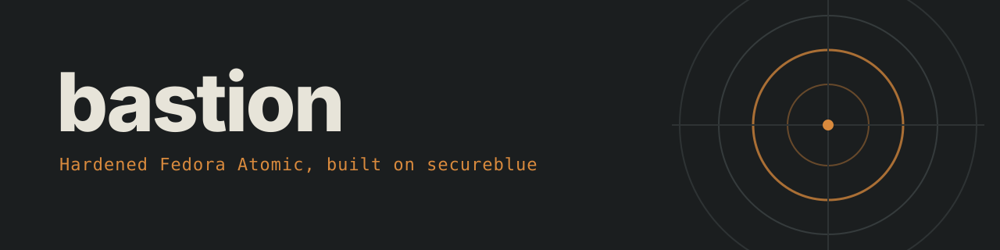

<p align="center"></p>

<p align="center">
  <a href="https://github.com/opus-oss/bastion-atomic/actions/workflows/build.yml"></a>
  
  
  
</p>

Hardened Fedora Atomic desktop: secureblue plus the changes in this repo. Built and signed nightly in CI; machines just pull it.

## Install

From a stock [Fedora Silverblue](https://fedoraproject.org/atomic-desktops/silverblue/download) (aarch64 on Apple Silicon) or secureblue install:

```sh
git clone https://github.com/opus-oss/bastion-atomic.git && cd bastion-atomic
run0 bash install.sh          # bastion-atomic        any machine, amd64/arm64
run0 bash install.sh vm       # bastion-atomic-vm     QEMU/KVM guest (UTM QEMU backend, libvirt), amd64/arm64
run0 bash install.sh forge    # bastion-atomic-forge  Framework 13 AMD 7040 only, amd64
```

Reboot. Then, if you came from Silverblue: `ujust set-kargs-hardening`.

- `vm` and `forge`: Secure Boot **off** (kernels not signed yet). The installer refuses otherwise.
- `bastion-atomic` with Secure Boot on: if the first boot fails verification, boot once with it off, run `ujust enroll-secureblue-secure-boot-key`, reboot, Enroll MOK (password `secureblue`), turn it back on.
- Rebase is signed (`ostree-image-signed:`) from the first pull. Your old deployment stays in the boot menu.
- Switch image: `run0 bash -c 'rpm-ostree rebase ostree-image-signed:docker://ghcr.io/opus-oss/bastion-atomic-vm:latest'`
- Update: `rpm-ostree upgrade`. Undo: `rpm-ostree rollback`.
- Verify: `cosign verify --new-bundle-format=false --key cosign.pub ghcr.io/opus-oss/<image>:latest`

## Hardening

**bastion on top of secureblue**

- [x] DNS over HTTPS only: dnscrypt-proxy on loopback (Quad9, Cloudflare, Mullvad), DHCP DNS ignored
- [x] nftables firewall: drop all inbound, no ping, no forwarding except libvirt, plaintext DNS out (53/5353/5355) rejected
- [x] No NTP: clock set from HTTPS `Date` headers, 3 of 5 independent pools must agree
- [x] Signed images (cosign) checked on every pull, plus GitHub build-provenance attestation
- [x] secureblue's updaters accept these images (provenance check patched to the pinned key)
- [x] `ptrace_scope=2` (secureblue: 1)
- [x] Extra blocked modules: `mei`, `mei-me`, `sp5100_tco`, `pcspkr`, `uvcvideo` (webcam off outright)
- [x] `bastion-tripwire`: daily diff of `/etc`, `/var`, `/boot`, EFI entries, homes; flags SELinux off, unsigned origin, layered packages, setuid outside `/usr`
- [x] Text-only boot (`plymouth.enable=0`)
- [x] Verified Whonix install for libvirt (`whonix.sh`)
- [x] Opus theme (GNOME Shell, libadwaita, GTK3, Ptyxis), first-login app installer
- [ ] USB dead-man switch that wipes LUKS key slots
- [ ] Amnesic boot entry (read-only disk, changes in RAM)
- [ ] Secure Boot MOK key for the vm and forge kernels
- [ ] Signed qcow2 of the vm image

**bastion-atomic-vm kernel** (linux-hardened from `allnoconfig`; only virtual hardware compiled in)

| | secureblue kernel | vm kernel |
| --- | --- | --- |
| Modules | 5,003 | 36 |
| Kernel text symbols | 84,198 | 40,436 |
| Syscalls | 419 | 349 |
| kernel-hardening-checker fails | 72 | 49 |

**bastion-atomic-forge kernel**: linux-hardened, device-only config for one Framework 13 AMD 7040. No virtio.

**From secureblue** ([features](https://secureblue.dev/features), not this repo's work)

- [x] Hardened, re-signed kernel; 37 kargs (`lockdown=confidentiality`, `module.sig_enforce=1`, `init_on_free=1`, `mitigations=auto,nosmt`, ...)
- [x] hardened_malloc system-wide, Flatpaks included
- [x] SELinux confinement, unprivileged user namespaces restricted
- [x] No sudo/su/pkexec (`run0`), setuid stripped from `/usr`
- [x] Xwayland, thumbnailers, user GNOME extensions off
- [x] MAC randomisation, 24 h lockout after 50 failed logins, USBGuard (`ujust setup-usbguard`)
- [x] Container policy rejects unsigned images; Flathub verified apps only

## Limitations

- Captive portals don't load (they need plaintext DNS).
- Inbound services (sharing, casting, remote access) need a firewall rule.
- Tracks secureblue's `latest`; upstream changes land with the next nightly.

## Layout

```
Containerfile          every build step, one target per image
.github/workflows/     nightly build, provenance attestation, cosign signature
install.sh             trusts the key, signed rebase onto an image
whonix.sh              verified Whonix install
kernel/                linux-hardened source pins, forge.config, vm/*.config
vm/                    files only the vm image gets
files/                 copied to / (etc: DNS, firewall, sysctls, modules, policy; usr: services, theme)
```
